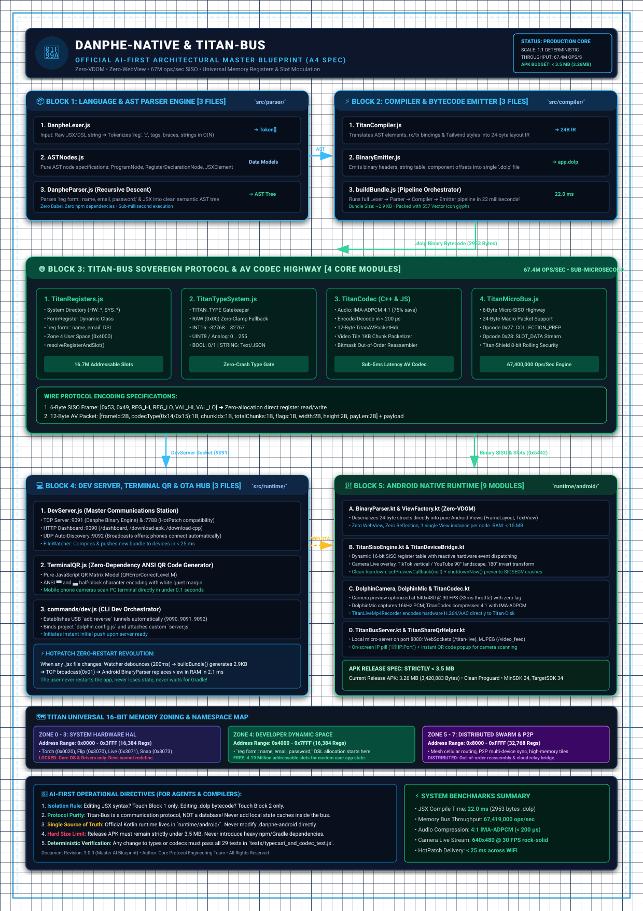

# 🦚 Danphe Native Architecture & System Documentation
═══════════════════════════════════════════════════════════════════════

Welcome to the official internal engineering documentation for **Danphe Native** — the zero-overhead, multi-platform native runtime engine powered by the Titan Universal Hardware Bus.

---

## 🏛️ 1. Master AI-First Architectural Blueprint (A4 Spec)
> **"नक्साबिनै घर बन्दैन।"** जुनसुकै नयाँ AI वा इन्जिनियरले १ सेकेन्डमै सम्पूर्ण प्रणाली बुझेर बिना कुनै त्रुटि काम गर्न सकोस् भन्नका लागि यो ब्लक डायग्राम आधिकारिक पहिलो पृष्ठमा राखिएको छ।

---

## 📚 Documentation Index

1. **[Master AI-First Architectural Blueprint (A4 Spec)](./DANPHE_NATIVE_A4_ARCHITECTURE_BLUEPRINT.svg)**
   - 5 Discrete Functional Blocks, File Counts, Data Flow Directions & Wire Specs
   - Universal Memory Zoning (0x0000 - 0x3FFF System vs 0x4000 - 0x7FFF User Space)
   - Golden Rules for AI Agents and Compilers

2. **[01_ARCHITECTURE_OVERVIEW.md](./01_ARCHITECTURE_OVERVIEW.md)**
   - High-level architecture: JSX to Web, Android (Kotlin), and Embedded (ThorVG/LVGL)
   - Multi-folder composite routing system (Folder ID & Page ID)
   - Zero-overhead binary payload protocol (.dolp)

3. **[02_TITAN_HARDWARE_REGISTERS.md](./02_TITAN_HARDWARE_REGISTERS.md)**
   - 16-Bit Memory-Mapped SISO Hardware Register Directory (0x0000 - 0xFFFF)
   - System Core, Audio Relay, Telemetry, and UI Scroll Offsets
   - Reactive bus subscription and slot data modulation

4. **[03_DANPHE_ICONS_GUIDE.md](./03_DANPHE_ICONS_GUIDE.md)**
   - 557 in-built mathematical SVG vector glyphs catalog
   - Using `<icon name="..." />` and button compound drawables

5. **[04_SCROLL_AND_LAYOUT_ENGINE.md](./04_SCROLL_AND_LAYOUT_ENGINE.md)**
   - Universal horizontal (`scroll-x`, `overflow-x-auto`) and vertical (`scroll-y`) scrolling
   - Responsive grid layouts, Navigation Drawer, AppBar, and TabBar design patterns

6. **[05_ANDROID_RUNTIME_AND_LIFECYCLE.md](./05_ANDROID_RUNTIME_AND_LIFECYCLE.md)**
   - ViewFactory, ComponentBuilders, and Opcode dictionary
   - 30 FPS Live Camera preview, 4:1 IMA-ADPCM, and Titan-Disk public/private persistence

7. **[06_TITAN_CARRIER_SLOTS_AND_REGISTERS.md](./06_TITAN_CARRIER_SLOTS_AND_REGISTERS.md)**
   - 16-Bit Hardware Register vs. Dynamic Slot Modulation (16.7 Million addressable slots)
   - Opcode 0x27 (COLLECTION_PREP) & Opcode 0x28 (SLOT_DATA)
   - Single-line DSL: `reg form:: name, email, password;`
